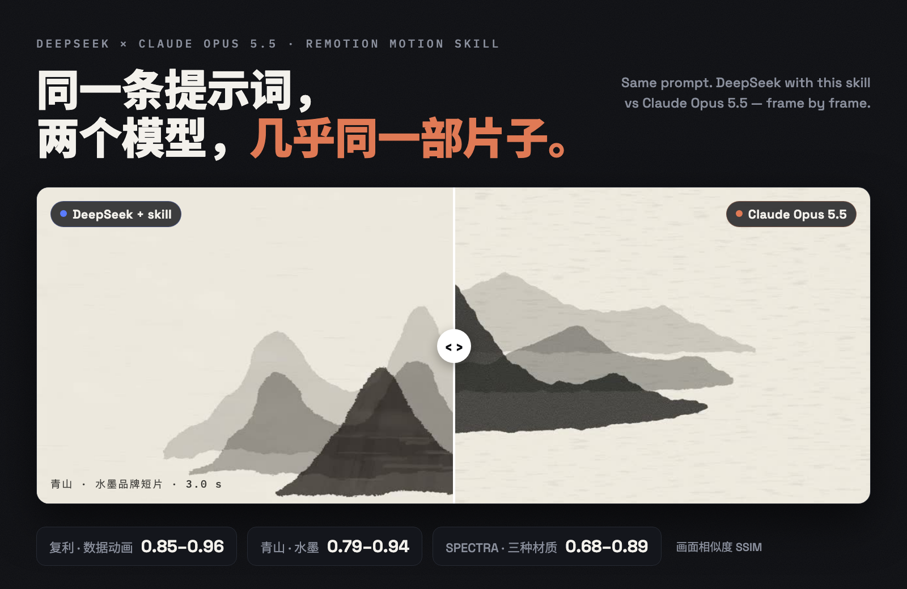
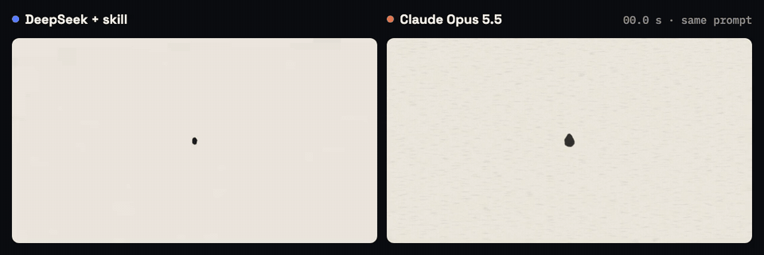
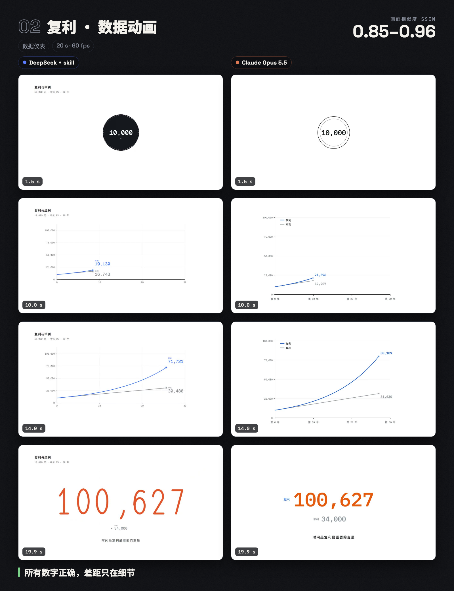
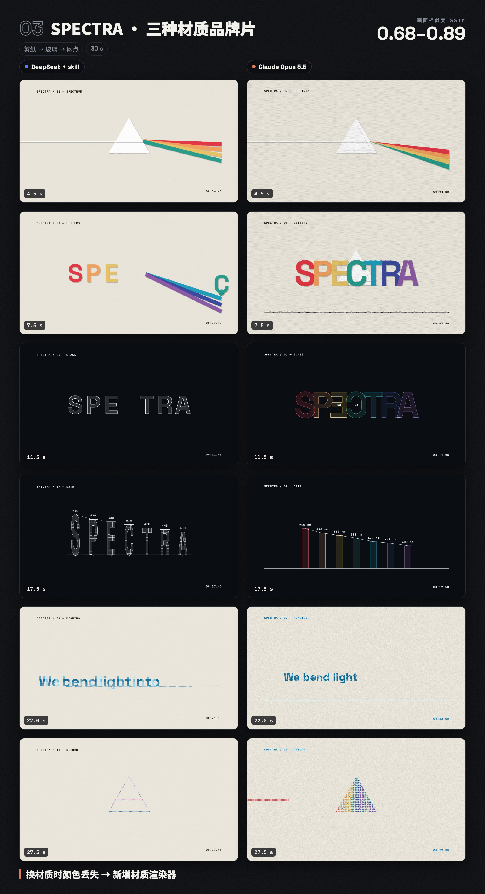

# DeepSeek × Opus 5.5 动效复刻 Skill

**让 DeepSeek 用和 Claude Opus 5.5 同样的提示词，做出效果接近的动效视频。**

这是一个 skill，适用于 DeepSeek，也适用于其他支持 skill 的模型和 agent。你像平时给 Opus 发提示词一样发给它，它会按 Opus 的工作方式完成一个 Remotion（React + SVG）动效项目：
1. 读懂提示词里的每个要求；
2. 把模糊的描述变成具体的设计决定；
3. 先规划时间线，再写代码；
4. 生成配乐；
5. 自己评审，然后修复。

题材和风格不限：品牌片、展示片、动态文字、数据讲解、产品界面演示、角色故事和 MV、抽象循环动画都可以。

> English: A skill that makes DeepSeek (or any model) produce Remotion motion-design films close to what Claude Opus 5.5 makes from the same prompt. It adds a priority order, a method for deriving a style from any prompt, playbooks for nine element types, a tested Remotion starter with motion, material, character-rig and sound helpers, and a five-juror self-review.





*同一条水墨提示词，左边是 DeepSeek 加本 skill，右边是 Claude Opus 5.5，同步播放前 12 秒。*

📖 **完整教程和全部测试视频：[docs/教程.md](docs/教程.md)**

## 为什么需要它

DeepSeek 和 Opus 的差距，大多不在审美，而在做事的方式。Opus 会默默做到下面这些，较弱的模型往往会跳过：
- 提示词里的每个数值都照做，后半段也不漏；
- 把“好看一点”“有质感”这类话变成具体的设计决定；
- 每个元素都认真设计，不拿占位图形凑数；
- 写代码之前先排好整条时间线；
- 搭一套统一的系统，保证前后一致；
- 回头检查自己的成果，然后修。

这个 skill 把这些行为写成明确的流程和工具，结构参考了 [Open Design](https://github.com/nexu-io/open-design)：

| Open Design | 本项目 |
| --- | --- |
| 功能 skill 统管流程 | `SKILL.md`：优先级、7 个阶段、9 类元素的做法 |
| `DESIGN.md` 设计规范 | `src/spec.ts` 顶部的设计规范；`design-systems/` 里的 7 个风格种子 |
| 设计模板 | `templates/remotion-starter/`，测试过的 Remotion 起步项目 |
| Design Jury 评审 | 五位评委：需求、连贯、节奏与声音、设计、工艺；8 分以上才交付 |
| 反模板感清单 | 禁用项 |

## 快速开始

### 1. 安装 skill

把 [`motion-design-prompt-generator/`](motion-design-prompt-generator) 整个文件夹放进你所用工具的 skills 目录：比如 DeepSeek 的 skill 安装入口，或者 Claude Code 的 `~/.claude/skills/`。

只能装单个文件的平台，只装 `SKILL.md` 也能用。

### 2. 准备一次 Remotion 项目

需要 Node.js 22 以上；如果要用自查脚本，还需要 ffmpeg。

```bash
cp -R motion-design-prompt-generator/templates/remotion-starter my-film
```

```bash
cd my-film && npm install
```

如果提示 esbuild 需要批准，再运行：

```bash
npm approve-scripts esbuild && npm rebuild esbuild
```

### 3. 做一个片子

1. **新开一个 DeepSeek 对话**，把提示词原样发给它，内容和发给 Opus 的一样。
2. 把它给的 `src/spec.ts`、`src/lib/film.tsx`、`src/Film.tsx`、`src/scenes/*.tsx`、`scripts/cues.json` 放进项目。
3. 预览、导出、自查：

```bash
npm run studio
```

```bash
npm run render
```

```bash
npm run check
```

4. 有问题就截图发给它，说“评审修复”。

可直接拿来试的提示词在 [`test-prompts/`](test-prompts)。

## 测试结果

“画面相似度”是 DeepSeek 版和 Opus 版在相同时间点的灰度 SSIM，范围 0–1，越高越接近。

| 测试 | 风格 | 画面相似度 | 结论 |
| --- | --- | --- | --- |
| 青山 · 旧版 skill | 水墨 | 0.74–0.82 | 叠加代替变形，铺满画面，噪声配乐 |
| 青山 · 新版 skill + 新对话 | 水墨 | **0.79–0.94** | 真变形、留白、物体结构都对齐了 |
| 复利 | 数据仪表 | **0.85–0.96** | 数字全对，只差细节 |
| SPECTRA | 三种材质 | 0.68–0.89 | 换材质时颜色丢了，促成了材质渲染器 |
| 雨中站台 | 角色故事 | 0.40–0.49 | 场景、光线、字幕都比较弱，促成了故事类规则和角色骨架 |

<table>
<tr>
<td></td>
<td></td>
</tr>
</table>

每组的视频、对比卡和分析，见[教程](docs/教程.md)。

## 项目结构

```
motion-design-prompt-generator/   ← skill 本体（安装这个文件夹）
  SKILL.md                        流程、规则、工具接口说明（约 24 KB）
  REFERENCE.md                    起步项目全部源码
  design-systems/                 7 个风格种子（只在提示词没写风格时作为起点）
  templates/remotion-starter/     测试过的 Remotion 项目
    src/lib/motion.tsx            动效工具：时间、缓动、变形、汇聚、材质渲染、角色骨架、纹理、遮罩、文字
    scripts/score.mjs             配乐合成器：13 种音色，含雨、风、室内环境音，循环无缝
    scripts/check.sh              自查：格式、首帧、循环接缝、声音频谱、运动曲线
  examples/                       机制演示（不是风格模板）
test-prompts/                     测试用提示词
docs/教程.md                      教学文档和全部对比视频
```

## 已知限制

- 目前只用 4 类提示词测试过。换成没测过的风格，效果需要自己验证。
- 配乐是代码合成的，音色比较简单；对音乐要求高的片子，建议后期换成真实配乐。
- 通过微信发送的视频会被压缩成 720p、30 fps。核对格式时，请用项目里 `out/film.mp4` 的原文件。
- [Remotion 的许可证](https://www.remotion.dev/license)对个人和小团队免费，公司使用请先确认条款。

## 许可证

[MIT](LICENSE)。本仓库依赖的 Remotion 使用它自己的许可证，见上方“已知限制”。

## 致谢

- [Remotion](https://www.remotion.dev)
- [Open Design](https://github.com/nexu-io/open-design)
- [HyperFrames](https://github.com/heygen-com/hyperframes)
- [huashu-art-motion](https://github.com/alchaincyf/huashu-art-motion)
