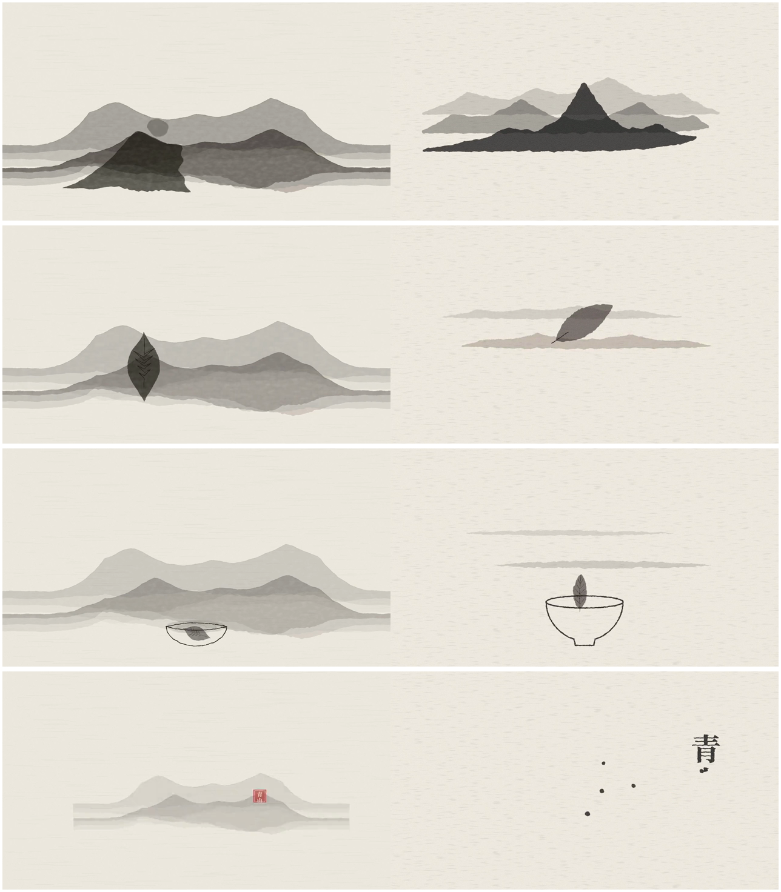
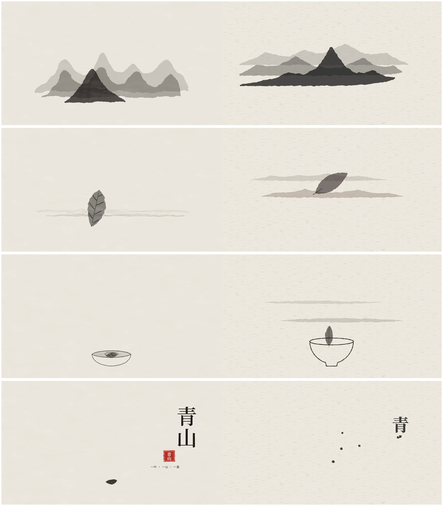
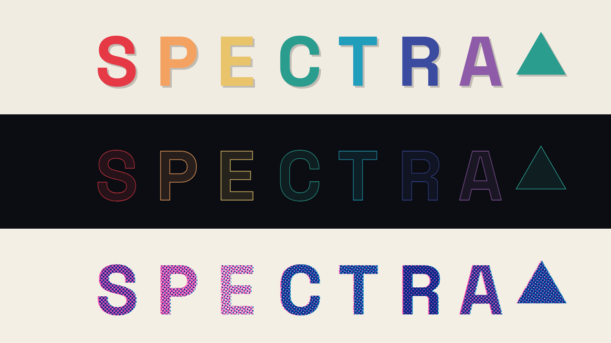
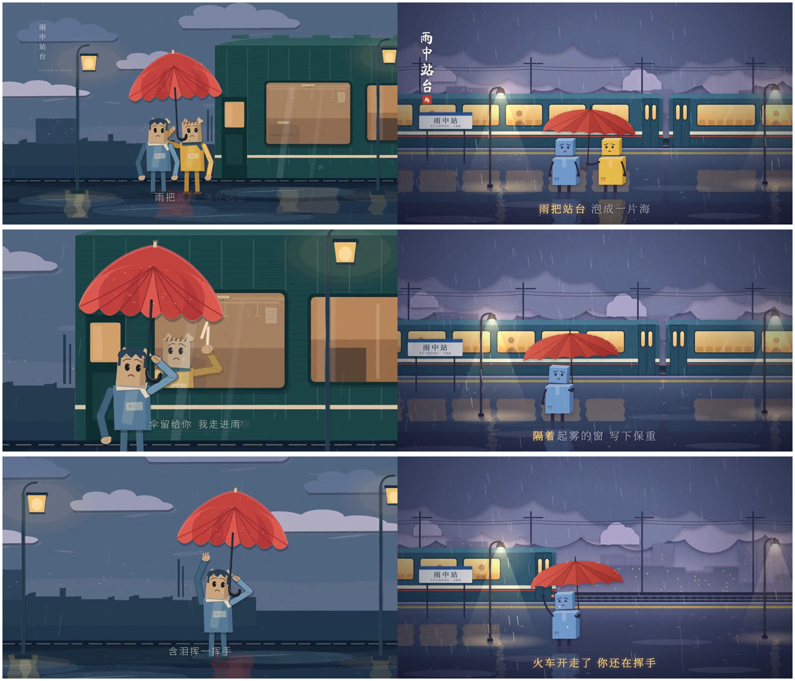
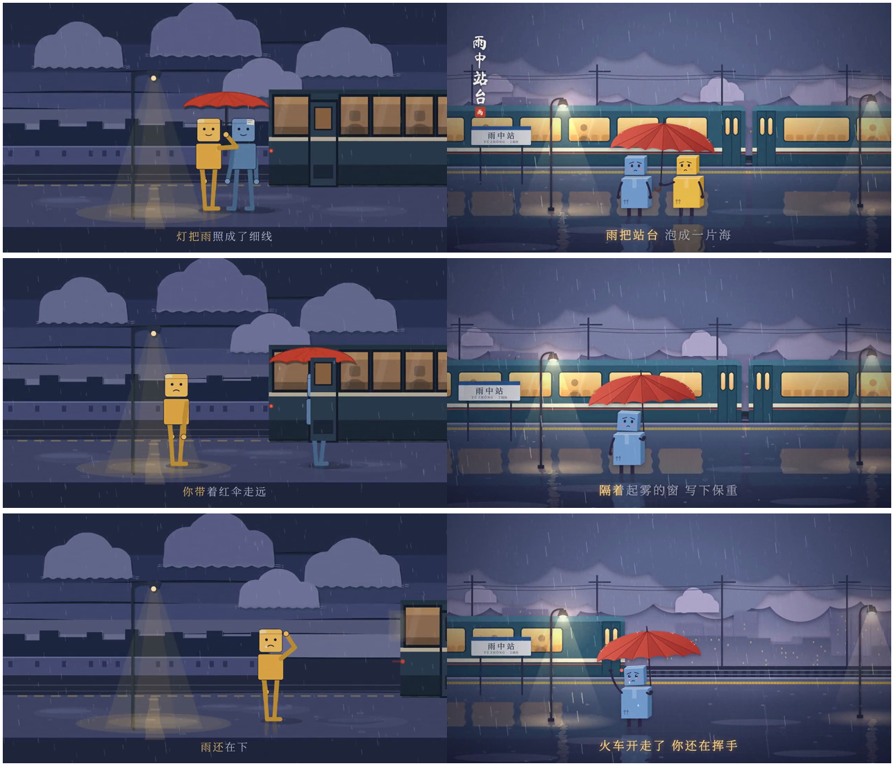

# 教程：用 DeepSeek 做出 Opus 5.5 级别的动效视频

这份教程教你用这个 skill，让 DeepSeek 拿到和 Opus 5.5 一样的提示词，做出效果接近的 Remotion 动效视频。后半部分是四组真实测试的复盘，每组都有视频和对比图，可以看到每一轮 skill 改了什么、效果怎么变化。

## 目录

1. [准备工作](#1-准备工作)
2. [安装 skill](#2-安装-skill)
3. [做第一个片子](#3-做第一个片子)
4. [提示词怎么写](#4-提示词怎么写)
5. [评审修复：怎么让它越改越好](#5-评审修复怎么让它越改越好)
6. [案例复盘（含视频）](#6-案例复盘含视频)
7. [经验总结](#7-经验总结)
8. [常见问题](#8-常见问题)
9. [skill 的工作原理](#9-skill-的工作原理)

---

## 1. 准备工作

| 需要什么 | 用途 | 怎么确认 |
| --- | --- | --- |
| DeepSeek（网页版、App 或支持 skill 的 agent） | 生成代码 | 能上传文件或安装 skill |
| Node.js 22 以上 | 运行 Remotion | 终端里运行 `node -v` |
| ffmpeg | 自查脚本 `npm run check` 要用 | 终端里运行 `ffmpeg -version` |
| Chrome | Remotion 预览 | — |

Mac 上可以用 Homebrew 安装 Node 和 ffmpeg：

```bash
brew install node ffmpeg
```

## 2. 安装 skill

1. 下载本仓库，找到 `motion-design-prompt-generator/` 文件夹。
2. 放进 skills 目录：
   - **DeepSeek**：在 DeepSeek 的 skill 安装入口里安装整个文件夹。如果你的版本只能装单个文件，装 `SKILL.md` 也能用。
   - **Claude Code**：复制到 `~/.claude/skills/motion-design-prompt-generator/`。
   - **其他 agent**：放进它的 skills 目录。
3. 复制一份起步项目，以后每个片子都可以从它开始：

```bash
cp -R motion-design-prompt-generator/templates/remotion-starter my-film
```

```bash
cd my-film && npm install
```

如果提示 esbuild 需要批准，运行：

```bash
npm approve-scripts esbuild && npm rebuild esbuild
```

## 3. 做第一个片子

> ⚠️ **每做一个新片子，都要新开一个 DeepSeek 对话。** 在老对话里，它会沿用上一版代码修修补补，新规则就用不上（见[案例 1](#案例-1青山水墨品牌短片)）。

**第 1 步：发提示词。** 把提示词原样发给 DeepSeek，内容和你发给 Opus 的完全一样。可以先用 [`test-prompts/`](../test-prompts) 里的现成提示词练手。

**第 2 步：看它的回复。** 正常情况下，回复依次包括：
1. **解读**：它选了什么风格、补了哪些假设；
2. **三张清单和时间线**：需求（S）、变形（X）、元素（E）；
3. **代码文件**：`src/spec.ts`、`src/lib/film.tsx`、`src/Film.tsx`、`src/scenes/SceneNN.tsx`、`scripts/cues.json`；
4. **核对表**：每处变形用了哪个工具、每个元素画了哪些结构；
5. **五项评分**和三个最没把握的地方。

如果回复里没有“解读”和三张清单，说明 skill 没被调用，检查一下是否装好了。

**第 3 步：放进项目。** 把每个代码块按标题里的路径存进 `my-film/`。不再使用的 `src/scenes/Scene01.tsx` 要删掉。

**第 4 步：预览和导出。**

```bash
npm run studio
```

浏览器里会打开 Remotion Studio，可以拖动时间轴逐帧看。它会先根据 `cues.json` 自动生成配乐。

```bash
npm run preview
```

导出半分辨率的小样，速度快。

```bash
npm run render
```

导出正式的 `out/film.mp4`。

**第 5 步：自查。**

```bash
npm run check
```

凡是报 `FAIL` 的地方都要修，见[第 5 节](#5-评审修复怎么让它越改越好)。

## 4. 提示词怎么写

skill 能处理任何长度的提示词，但写得越具体，结果越可控。

**一句话创意**：skill 会先自动扩写成完整的脚本，再开始做。

```text
一个叫“青山”的茶叶品牌的 15 秒循环短片。
```

**中等长度**（推荐）：写清楚以下几项，其余交给 skill 补。
- **概念**：一句话说清楚什么东西变成什么东西；
- **风格**：配色（最好给色值）、材质、字体；
- **画面**：尺寸、帧率、留白；
- **节奏**：BPM，或者“舒缓”“干脆”；
- **分镜**：按秒写，每段写清楚谁变成谁；
- **禁止项**。

**长提示词**：每个场景都写到具体数值，skill 会逐条记进需求清单，逐条核对。

**几个小技巧：**
- **用“变成”描述转场。** “茶叶落进杯子”“曲线拉直变成数字”这类写法，skill 会按真变形来处理，不会用淡入淡出糊过去。
- **数值一定照做。** 色值、字号、坐标、秒数都会原样执行，所以写之前想清楚。
- **在末尾加一句格式要求**，比如 `Build it as a Remotion (React + SVG) project, 1920×1080, 60 fps.`，两边的输出格式就一致，方便对比。
- **想要配乐风格就写出来**，比如“古琴”“轻电子”“雨声”。不写，skill 也会按风格配一段。
- **只想要扩写后的提示词**，就说“只要提示词”。

## 5. 评审修复：怎么让它越改越好

`npm run check` 的输出解读：

| 输出 | 意思 | 怎么做 |
| --- | --- | --- |
| `FAIL width/height/fps/duration` | 视频格式和 `spec.ts` 不一致 | 让它按提示词改回 `FILM`；想渲染快一点就用 `npm run preview` |
| `FAIL ... starter placeholder` | `spec.ts` 还是起步项目的占位内容 | 让它按提示词重写 `spec.ts` |
| `FAIL frame 0 background` | 开头闪色 | 截图第 0 帧和第 1 秒发给它 |
| `FAIL loop seam` | 循环片首尾对不上 | 截图首帧和尾帧发给它 |
| `FAIL ... no audio` | 设置了配乐但视频里没有声音 | 检查 `cues.json` 和 `FILM.sound` |
| `<-- spike` | 运动曲线上有突然的大变化 | 如果不是计划中的转场，就是节奏有问题 |
| `(still)` 连成一片 | 画面长时间静止 | 如果不是计划中的停留，说明那里缺动作 |
| `out/check/audio.png` 全是平整的噪声块 | 配乐不像音乐 | 让它改 `cues.json`，用有音高的乐器 |

**评审修复的标准做法：**
1. 截 4–6 张关键帧：开场、每次转场的中间、最重要的画面、结尾。用 `TIMES="4.8 10 19.9" npm run check` 可以一次生成，在 `out/check/` 里。
2. 在**同一个对话**里上传截图，说“评审修复”。
3. 它会重新按五项打分，只发改动过的文件。替换后重新导出。
4. 最多三轮。如果还有个别问题，单独说清楚，比如“第 7 秒的 10 齿齿轮没咬合，只改 Scene07”。

## 6. 案例复盘（含视频）

下面是开发过程中的四组真实测试。对比图里**左边是 DeepSeek，右边是 Opus 5.5**。DeepSeek 的视频经过微信传输，被压缩成了 720p、30 fps。

### 案例 1：青山（水墨品牌短片）

提示词：[`test-prompts/01-青山-水墨品牌短片.txt`](../test-prompts/01-青山-水墨品牌短片.txt)

视频：
- [▶ Opus 5.5](media/videos/01-qingshan-opus.mp4)
- [▶ DeepSeek 第 1 版（旧 skill）](media/videos/01-qingshan-deepseek-1-old-skill.mp4)
- [▶ DeepSeek 第 2 版（新 skill，但在老对话里）](media/videos/01-qingshan-deepseek-2-same-chat.mp4)
- [▶ DeepSeek 第 3 版（新 skill，新对话）](media/videos/01-qingshan-deepseek-3-new-chat.mp4)

**第 1 版 vs Opus**，相似度 0.74–0.82：



| 问题 | 原因 | skill 的对策 |
| --- | --- | --- |
| 远山从头到尾没变，茶叶是叠在山上新冒出来的 | 用叠加代替变形 | 规则：“变成”必须是同一个物体逐点变形；新工具 `chain()`、`converge()` |
| 山从左边缘铺到右边缘 | 不懂水墨要留白 | 每个风格规定画面占用率和留白 |
| 叶子是对称的梭形，茶杯是个浅碟 | 画成了符号，不是真东西 | 元素做法：每个物体先列出 3 个以上结构特征 |
| 结尾整个画面缩小成缩略图 | 用缩放糊过变形 | 规则：禁止整体缩放冒充变形 |
| 没有声音（Opus 自己加了配乐） | — | 默认配乐，新增配乐合成器 `score.mjs` |

**第 2 版**：和第 1 版画面相似度高达 0.94–0.99，几乎没变。原因是**在同一个对话里**跑的，DeepSeek 把旧代码当基础改了改。**对策**：skill 规定每个新提示词都从头新建，教程也提醒新开对话。

**第 3 版 vs Opus**，新开对话，相似度 **0.79–0.94**：



山收拢在画面中部，最近的山峰变成了茶叶，另外两层化成雾，结尾各元素化成墨点汇聚，变形和留白都对齐了。剩下的问题是配乐还是噪声块，对策是让配乐合成器在代码里直接拒绝没有音高的配乐。

### 案例 2：复利（数据动画）

提示词：[`test-prompts/02-复利-数据动画.txt`](../test-prompts/02-复利-数据动画.txt)

视频：
- [▶ Opus 5.5](media/videos/02-compound-opus.mp4)
- [▶ DeepSeek](media/videos/02-compound-deepseek.mp4)

相似度 **0.85–0.96**，四组里最接近的一组：


所有数字都对，包括中间滚动的计数，比如第 27.2 年复利 81,120、单利 31,760。差距都在细节上：

| 细节 | DeepSeek | Opus | skill 的对策 |
| --- | --- | --- | --- |
| 自己多加了文字 | 左上角加了标题和参数 | 没有 | 小细节不许添加提示词没给的文案 |
| 横轴标签 | `0 / 10 / 20 / 30` | `第 0 年…`，和提示词原话一致 | 提示词规定了措辞的，照原话用 |
| 结尾大数字 | 细体 | 最粗的等宽体 | 关键文字用全片最粗、最大的字 |

### 案例 3：SPECTRA（三种材质切换的品牌片）

提示词：[`test-prompts/03-SPECTRA-多材质品牌片.txt`](../test-prompts/03-SPECTRA-多材质品牌片.txt)

视频：
- [▶ Opus 5.5](media/videos/03-spectra-opus.mp4)
- [▶ DeepSeek](media/videos/03-spectra-deepseek.mp4)

相似度 0.68–0.89：


| 问题 | skill 的对策 |
| --- | --- |
| 玻璃段七个字母全变成灰色；网点段只剩两色 | **材质渲染器 `MaterialLayer`**：形状只定义一次，每个形状只记它的颜色编号，再分别渲染成纸片、玻璃、线稿、平涂、网点。网点模式会把每种颜色换算成各油墨的网点比例 |
| 楼没变成柱状图，只是加了标签 | 规则：变形必须到达目标形态 |
| 字母不是从色带末端卷出来的 | 规则：碎片从源头的位置生成，再移动过去 |
| 标语单词之间没有空格 | 规则：拆字做动画时必须保留空格 |

这个材质渲染器来自 Opus 源码的做法：一套形状，加每种材质各自的渲染器。下图是同一组七色字母在三种材质下的效果：



### 案例 4：雨中站台（角色故事 / MV）

视频：
- [▶ Opus 5.5](media/videos/04-rain-opus.mp4)
- [▶ DeepSeek 第 1 版](media/videos/04-rain-deepseek-1.mp4)
- [▶ DeepSeek 第 2 版（第一版角色骨架）](media/videos/04-rain-deepseek-2-rig.mp4)

**第 1 版 vs Opus**，相似度 0.40–0.49：



| 问题 | skill 的对策 |
| --- | --- |
| 镜头推拉、裁切 | 故事片开场先用固定远景交代整个世界 |
| 场景单薄 | 场景分层：天空、远景、中景、地面、前景 |
| 光感弱 | 光来自具体光源：路灯光锥、亮窗、倒影。这类用形状画出来的光不算“发光”禁用项 |
| 小号灰字压在灰底上，看不清 | 字幕规则：至少 40 px、高对比、停留时间够读完 |
| 雨声断断续续 | 配乐合成器新增环境音：雨、风、室内，可以整段铺底 |
| 撑伞的手在额头上，伞柄没在手里 | **角色骨架**：角色只定义一次，按关节摆姿势，道具挂在手上 |

**第 2 版（第一版骨架）**：字幕和镜头变好了，但角色退化成了火柴人：



**这是一次很有价值的失败**：骨架默认的外观太简陋，DeepSeek 直接照搬成了角色设计。对策：
- 写进总原则：**工具只管机制，不定外观**。
- 骨架默认画法升级：四肢有体积和暗面，手和鞋有形状，每个部位都可以自定义。
- 示例改成用同一套骨架做出两个完全不同的角色：


## 7. 经验总结

这些是从四组测试里总结出来的、对任何需求都适用的经验：

1. **差距在做事的方式，不在审美**：让较弱的模型一步步按 Opus 的方式做，比教它“什么是好看”有效得多。
2. **能用代码拦住的，就别只写成规则**：格式、配乐、首尾帧这类问题，规则写了模型也会忘，放进脚本里自动报错才可靠。
3. **工具只管机制，不定外观**：工具的默认样子会被直接照搬，所以默认值要中性、精致，示例要刻意做得五花八门。
4. **规则不是越多越好**：SKILL.md 从 75 KB 瘦身到 24 KB 之后，模型才有余力顾及画面美术。规则之间要有优先级。
5. **一个新片子一个新对话**：老对话会把旧代码当成基础。
6. **按元素类型思考**：任何需求都可以拆成文字、物体、角色、场景、数据、界面、转场、质感和光、声音这九类，每类有固定的做法和常见错误。
7. **变形要真变**：同一个物体逐点变形、到达目标形态、碎片从源头生成、数量守恒。这是“像 Opus”最直观的一点。
8. **换材质不能丢身份**：颜色、形状、位置跨场景都要保持。
9. **先出静帧，再做动画**：静帧不好看，动起来也救不回来。
10. **自查要看画面**：模型凭代码自评总会偏高，截图配合运动曲线才看得准。

## 8. 常见问题

**回复里没有“解读”和清单？**
skill 没被调用。检查是否安装成功，或者直接说“用 motion-design-prompt-generator 做这个”。

**`npm install` 之后报 esbuild 错误？**
运行 `npm approve-scripts esbuild && npm rebuild esbuild`。

**`npx remotion studio` 报找不到 `score.wav`？**
改用 `npm run studio`，它会先生成配乐。

**回复被截断了？**
说“继续”，它会从断开的文件接着写。

**画面是黑的？**
看终端或浏览器控制台的报错，把报错原文发给它。

**字体不对？**
字体从 Google Fonts 加载，需要联网。

**视频格式变成了 720p、30 fps？**
如果是通过微信发送的，那是微信压缩造成的。要核对格式，请用项目里 `out/film.mp4` 的原文件。

**和 Opus 的效果差得多，该怎么调？**
1. 用同样的时间点截两边的图，并排对比，找出差得最多的那一类元素。
2. 对照[第 9 节](#9-skill-的工作原理)，看是哪一步没做到。
3. 在同一个对话里截图让它“评审修复”。

## 9. skill 的工作原理

优先级：**提示词原话 > 画面与美术质量 > 连贯 > 节奏和声音 > 记录工作**。

| 阶段 | 做什么 |
| --- | --- |
| 0 读题 | 建三张清单：需求（每个数值）、变形（谁变成谁）、元素（每个要画的东西） |
| 1 补全 | 没写的地方按 Opus 的习惯补：时长、节奏、构图、字体、配乐…… |
| 2 定风格 | 提示词写了风格就照做；只有感觉就从种子改；只有一句话就按四步推导：题材 → 世界、情绪 → 能量、写成具体数值、排除模板感 |
| 3 时间线 | 先排好每个场景和每个动作的时间，再写代码 |
| 4 先设计 | 物体构建、角色设定图、关键帧静帧 |
| 5 实现 | 用起步项目和工具函数写 Remotion 代码 |
| 6 评审 | 五位评委打分：需求、连贯、节奏和声音、设计、工艺；8 分以上才交付，最多三轮 |
| 7 交付 | 解读、清单、代码、核对表、评分、运行方法 |

九类元素的做法、通用规则和工具函数接口，都在 [`SKILL.md`](../motion-design-prompt-generator/SKILL.md) 里。
